# Step 2: Market-Price Prediction & Data Audit Report

**Project:** Crop & Irrigation Planner  
**Component:** Market-Price Prediction Module  
**Status:** Completed & Validated  
**Artifacts Generated:**  
- Preprocessing script: [`src/prepare_price_data.py`](file:///c:/Users/Hima/OneDrive/Desktop/crop-irrigation-planner/src/prepare_price_data.py)  
- Clean training data: [`data/processed/price_training_data.csv`](file:///c:/Users/Hima/OneDrive/Desktop/crop-irrigation-planner/data/processed/price_training_data.csv)  
- Quality review audit: [`data/processed/price_data_reviewed.csv`](file:///c:/Users/Hima/OneDrive/Desktop/crop-irrigation-planner/data/processed/price_data_reviewed.csv)  
- Model training script: [`src/train_price_model.py`](file:///c:/Users/Hima/OneDrive/Desktop/crop-irrigation-planner/src/train_price_model.py)  
- Saved model pipeline: [`models/price_model.joblib`](file:///c:/Users/Hima/OneDrive/Desktop/crop-irrigation-planner/models/price_model.joblib)  
- Model metadata & metrics: [`models/price_model_metadata.json`](file:///c:/Users/Hima/OneDrive/Desktop/crop-irrigation-planner/models/price_model_metadata.json)  
- Comprehensive check script: [`src/check_price_model.py`](file:///c:/Users/Hima/OneDrive/Desktop/crop-irrigation-planner/src/check_price_model.py)  
- Inference demonstration: [`src/predict_price.py`](file:///c:/Users/Hima/OneDrive/Desktop/crop-irrigation-planner/src/predict_price.py)

---

## Part A — Data Audit of `data/raw/crop_price_dataset.csv`

### 1. Schema, Data Types, and Completeness
Inspection of the raw dataset without assuming its source yielded the following actual structure:

| Column Name | Raw Data Type | Non-Null Count | Missing Values | Role in Analysis |
| :--- | :--- | :--- | :--- | :--- |
| `month` | `object` (string) | 2,810 | 0 | Observation Date (first day of calendar month) |
| `commodity_name` | `object` (string) | 2,810 | 0 | Crop / Agricultural Commodity Identity |
| `avg_modal_price` | `float64` | 2,810 | 0 | **Primary Target Variable** (Market Modal Price) |
| `avg_min_price` | `float64` | 2,810 | 0 | Market Floor Price (auction summary statistic) |
| `avg_max_price` | `float64` | 2,810 | 0 | Market Ceiling Price (auction summary statistic) |
| `state_name` | `object` (string) | 2,810 | 0 | Geographic Level (Constant: `"India"`) |
| `district_name` | `object` (string) | 2,810 | 0 | Administrative Level (Constant: `"All"`) |
| `calculationType` | `object` (string) | 2,810 | 0 | Aggregation Cadence (Constant: `"Monthly"`) |
| `change` | `float64` | 2,794 | 16 | Month-over-month price delta: $P_t - P_{t-1}$ |

- **Total Rows & Columns:** 2,810 rows, 9 columns.
- **Duplicate Rows:** Exactly 0 duplicate rows.
- **Date Coverage:** 2010-01-01 to 2025-03-01 (183 continuous monthly intervals; 15 years and 3 months).
- **Missing Values:** Only `change` has 16 missing values. These 16 NaNs correspond exactly to the very first observation month for each of the 16 commodities (15 start in January 2010, Sugarcane starts in February 2010), where no prior month exists to compute difference.

### 2. Commodity and Geographic Breakdown
- **Unique Commodities (16 total):** Barley (Jau), Coconut, Coffee, Cotton, Ginger(Dry), Groundnut, Jowar(Sorghum), Maize, Millets, Rice, Sugar, Sugarcane, Sunflower, Tea, Turmeric, Wheat.
  - 13 crops have unbroken 183-month sequences (2010 to 2025).
  - Millets (171 months), Sugarcane (154 months), and Tea (106 months) have minor coverage gaps.
- **Geographic Scope:** `state_name` is exclusively `"India"` and `district_name` is exclusively `"All"`. The dataset represents a **national monthly aggregation**, not state-level or Karnataka-specific mandi records.

### 3. Price Unit Verification
- **Documentation Status:** The raw CSV file contains **no header unit definitions or accompanying documentation**.
- **Formal Status:** Explicitly marked as **UNKNOWN / UNVERIFIED** in metadata.
- **Market Reality & Alignment:**
  - In official Indian agricultural reporting (Agmarknet / Ministry of Agriculture), wholesale prices for grains, oilseeds, and pulses (e.g., Maize ₹1,500–₹2,400, Wheat ₹1,400–₹2,900, Rice ₹1,800–₹3,600, Cotton ₹3,000–₹10,000) strongly match **INR (₹) per Quintal (100 kg)**.
  - **Unit Inconsistencies:** 
    - *Sugarcane:* Ranges from ₹7 to ₹33,000 with a median of ₹325. Official Fair & Remunerative Price (FRP) is ~₹300–₹350/quintal; values like ₹7 likely reflect single cane stalks or bundles, while values >₹3,000 likely reflect processed gur/jaggery.
    - *Coconut:* Swings between ₹3,000 and ₹45,000. In APMC mandis, coconuts are quoted interchangeably per quintal (copra) or per 1,000 nuts.

### 4. Historical vs. Synthetic Verification
The data was audited for authenticity against major known historical events in Indian agriculture:
- **Turmeric 2010–2011 Bubble:** The famous Indian turmeric price spike is accurately preserved, starting at ₹9,507 in Jan 2010, peaking at ₹15,658 in Dec 2010, and steadily deflating through 2011 to ₹6,117.
- **Wheat 2022–2023 Rally:** Reflects the global commodity surge following the March 2022 heatwave and geopolitical conflict, rising from ₹1,800 to >₹2,800.
- **Conclusion:** The dataset contains **real historical market observations aggregated at the national level**, not synthetic noise or computer-generated distributions.

### 5. Identified Inconsistencies & Dataset Limitations
1. **Mathematical Inconsistencies (10 rows):**
   - 1 row where `avg_min_price > avg_modal_price` (Row 1688: Jowar in Dec 2012 has min=377,904.12 vs modal=1,541.25, an obvious manual data-entry error).
   - 9 rows where `avg_modal_price > avg_max_price`.
   - 3 rows where `avg_min_price > avg_max_price`.
2. **National Aggregation (No Local Mandi Resolution):** Lacks district-level spatial variation needed to differentiate regional Karnataka markets (e.g., Mysuru APMC vs Ballari APMC).
3. **Suitability for Training:** Suitable for learning long-term structural price levels, general inflation trends, and macro-seasonality for national planning, but **must be cleaned of corrupt rows** and **cannot be used for localized mandi arbitrage**.

---

## Part B — Preprocessing and Modeling

### 1. Transparent Non-Destructive Preprocessing (`src/prepare_price_data.py`)
- Leaves `data/raw/crop_price_dataset.csv` untouched.
- Removes the 10 mathematically inconsistent records.
- Adds `is_unit_volatile_crop` flag for Coconut and Sugarcane.
- Extracts calendar features (`year`, `month_num`, `quarter`).
- Retains 2,800 validated clean observations in `data/processed/price_training_data.csv`.
- Saves an auditable copy with all flags in `data/processed/price_data_reviewed.csv`.

### 2. Strict Target Leakage Prevention
To prevent target leakage during training and evaluation:
- `avg_min_price` and `avg_max_price` are **strictly excluded** from features because they are same-month summary statistics of the auction price distribution that would not be known at planning time.
- `change` ($P_t - P_{t-1}$) is **strictly excluded** because it leaks the contemporaneous price.
- Only features known in advance are used: `commodity_name`, `year`, `month_num`.

### 3. Chronological Train / Test Split
To avoid temporal lookahead bias, we apply a strict time-based split:
- **Training Period:** 2010-01 to 2021-12 (12 years, 2,218 records, ~79.2% of dataset).
- **Holdout Test Period:** 2022-01 to 2025-03 (3 years 3 months, 582 records, ~20.8% of dataset).
- Training strictly precedes testing; no test observations or future statistics are used during fitting.

### 4. Baseline Models vs. scikit-learn Model
Two simple, interpretable baselines were established to quantify model value:
1. **Baseline 1 (Crop Historical Mean):** Predicts the historical average modal price of the crop from the training set ($N=2,218$).
2. **Baseline 2 (Seasonal Crop-Month Mean):** Predicts the historical average price for that crop in that specific calendar month.
3. **Primary Model:** A scikit-learn `Pipeline` combining:
   - `ColumnTransformer`: `OneHotEncoder(handle_unknown="ignore")` for `commodity_name`, numeric passthrough for `year` and `month_num`.
   - `RandomForestRegressor(n_estimators=100, random_state=42, min_samples_leaf=2)`.

### 5. Evaluation Metrics & Comparison
Evaluated on the 582 unseen holdout records (2022–2025):

| Method | MAE (INR) | RMSE (INR) | $R^2$ | Value Added vs Baseline |
| :--- | :---: | :---: | :---: | :--- |
| **Baseline 1: Crop Historical Mean** | 1,983.23 | 3,030.84 | 0.534 | Naive reference |
| **Baseline 2: Seasonal Crop-Month Mean** | 1,992.43 | 3,072.12 | 0.522 | Captures month seasonality |
| **Random Forest Pipeline (Calendar Profile)** | **1,528.28** | **2,941.90** | **0.561** | **+22.9% MAE improvement** over baseline |
| *Reference: Lag-1 Persistence Baseline* | *290.57* | *764.85* | *0.970* | *Requires $P_{t-1}$; near-term forecasting only* |

- **Interpretation of $R^2$:** Across all 16 crops pooled together, $R^2 = 0.561$ confirms the model captures a substantial portion of variance across crops and years. However, because price scales range from ₹300 (Sugarcane) to ₹27,000 (Tea), pooled $R^2$ is heavily influenced by high-value crops. Sliced MAE and relative percentage error provide much more actionable insight.

---

## Part C — Sliced Performance & Saved Artifacts

### 1. Sliced Evaluation: Standard Field Crops vs. Unit-Volatile Crops

| Sliced Crop Group | Test Records ($N$) | Mean Actual Price (INR) | Baseline MAE | Model MAE | Model Relative Error | MAE Improvement |
| :--- | :---: | :---: | :---: | :---: | :---: | :---: |
| **Standard Field Crops** (14 crops) | 506 | ₹5,623.87 | ₹1,923.77 | **₹1,577.75** | **28.1%** | **+18.0%** |
| **Unit-Volatile Crops** (Sugarcane, Coconut) | 76 | ₹2,380.13 | ₹2,379.11 | **₹1,198.92** | 50.4% | **+49.6%** |

### 2. Per-Commodity Performance Breakdown (Test Period: 2022–2025)

| Commodity | Test $N$ | Mean Actual Price (INR) | Base MAE | Model MAE | Model RMSE | MAE Impr % | Rel Err % | Reliability Assessment |
| :--- | :---: | :---: | :---: | :---: | :---: | :---: | :---: | :--- |
| **Sugar** | 39 | ₹3,950.19 | ₹471.84 | **₹360.71** | ₹405.25 | +23.6% | **9.1%** | Excellent |
| **Groundnut** | 39 | ₹6,078.14 | ₹1,810.31 | **₹637.32** | ₹767.28 | +64.8% | **10.5%** | Excellent |
| **Sunflower** | 39 | ₹5,025.21 | ₹1,574.10 | **₹754.60** | ₹953.88 | +52.1% | **15.0%** | Excellent |
| **Millets** | 39 | ₹2,961.45 | ₹1,297.09 | **₹447.27** | ₹567.53 | +65.5% | **15.1%** | Excellent |
| **Rice** | 39 | ₹3,220.70 | ₹710.00 | **₹493.26** | ₹560.02 | +30.5% | **15.3%** | Very Good |
| **Cotton** | 39 | ₹7,565.86 | ₹2,984.96 | **₹1,478.47** | ₹1,867.69 | +50.5% | **19.5%** | Very Good |
| **Wheat** | 39 | ₹2,422.78 | ₹802.81 | **₹578.19** | ₹624.05 | +28.0% | **23.9%** | Good (2022 rally) |
| **Barley (Jau)** | 39 | ₹2,241.71 | ₹847.08 | **₹550.39** | ₹625.39 | +35.0% | **24.6%** | Good |
| **Maize** | 39 | ₹2,112.50 | ₹770.63 | **₹570.75** | ₹595.03 | +25.9% | **27.0%** | Good |
| **Turmeric** | 39 | ₹9,612.40 | ₹2,912.76 | **₹2,962.58** | ₹3,763.67 | -1.7% | **30.8%** | Moderate (Spice cycle) |
| **Jowar (Sorghum)** | 39 | ₹2,944.02 | ₹1,100.25 | **₹1,003.95** | ₹1,133.40 | +8.8% | **34.1%** | Moderate |
| **Coconut** | 39 | ₹4,137.14 | ₹3,795.86 | **₹1,688.31** | ₹2,317.29 | +55.5% | **40.8%** | Unit-distorted |
| **Coffee** | 37 | ₹17,171.44 | ₹6,589.51 | **₹7,500.99** | ₹9,184.55 | -13.8% | **43.7%** | Global supply shock |
| **Ginger (Dry)** | 39 | ₹7,848.04 | ₹3,287.99 | **₹3,474.09** | ₹4,528.02 | -5.7% | **44.3%** | High price volatility |
| **Tea** | 1 | ₹27,000.00 | ₹5,393.41 | **₹1,655.70** | ₹1,655.70 | +69.3% | **6.1%** | Limited test samples |
| **Sugarcane** | 37 | ₹528.15 | ₹885.78 | **₹683.08** | ₹925.05 | +22.9% | **129.3%** | Unit-distorted (₹7-33k) |

### 3. Analysis of Largest Prediction Errors
All top 10 largest prediction errors occurred on **Coffee in late 2024 and early 2025**:
- In late 2024/early 2025, severe droughts in Vietnam and Brazil triggered an extraordinary international coffee supply crisis, driving Indian coffee wholesale prices from the historical ₹10,000–₹12,000 range to **₹29,000–₹30,000/quintal**.
- Because the model was trained on historical data up to 2021 (where maximum coffee price was ~₹18,000), an out-of-distribution global shock cannot be predicted by a static calendar profile. This confirms why model users must be alerted when predicting volatile cash commodities.

---

## Critical Distinction: Historical Price Prediction vs. Future Price Forecasting

```mermaid
flowchart TD
    subgraph Historical_Price_Prediction["Historical / Contextual Price Level Prediction (Our Trained Model)"]
        A["Inputs: Crop, Year, Month"] --> B["Learned Patterns: Secular Trend + Crop Baseline + Seasonality"]
        B --> C["Output: Structural Expected Price Level"]
        C --> D["Use Case: Crop planning, multi-year farm budgeting, irrigation feasibility"]
    end

    subgraph Future_Price_Forecasting["Live Time-Series Forecasting (Autoregressive / Near-Term)"]
        E["Inputs: Recent Lag Prices (P_t-1, P_t-12), Mandi Arrivals, Live Weather"] --> F["Learned Patterns: Momentum, Shocks, Short-Term Autoregression"]
        F --> G["Output: Live Near-Term Price Forecast"]
        G --> H["Use Case: Immediate harvest selling decisions, mandi arbitrage"]
    end
```



1. **Historical / Contextual Price Prediction (Our Model):**
   - **Inputs:** Crop name, planning year, and month.
   - **Nature:** Estimates what price level is structurally consistent with the crop's long-term trend and seasonal pattern.
   - **Limitation:** Cannot anticipate unexpected geopolitical, weather, or export tariff shocks occurring years ahead.
2. **Future Price Forecasting:**
   - Requires live streaming data: previous month's price ($P_{t-1}$), current mandi arrival volumes, and real-time weather alerts.
   - Using $P_{t-1}$ for long-term planning before the crop is even sown is impossible and would constitute target leakage.

---

## Verification and Reproducibility

To reproduce all preprocessing, training, evaluation, and inference runs:
```bash
# 1. Prepare clean data from raw dataset
python src/prepare_price_data.py

# 2. Train model and generate saved artifacts
python src/train_price_model.py

# 3. Execute comprehensive check and evaluation
python src/check_price_model.py

# 4. Run interactive inference demo
python src/predict_price.py
```
